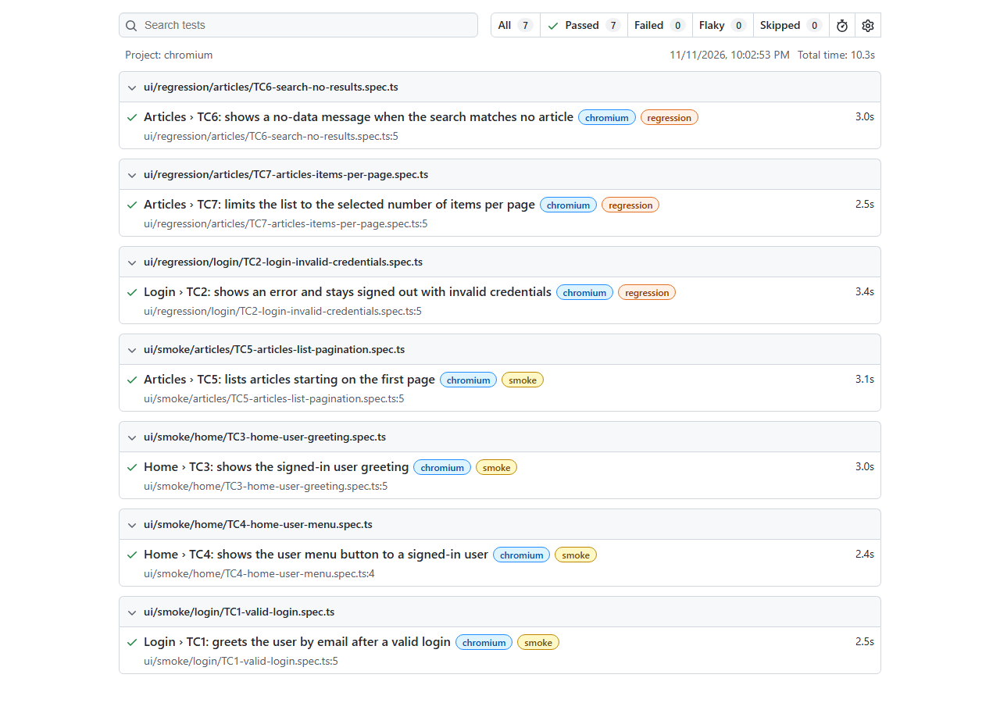
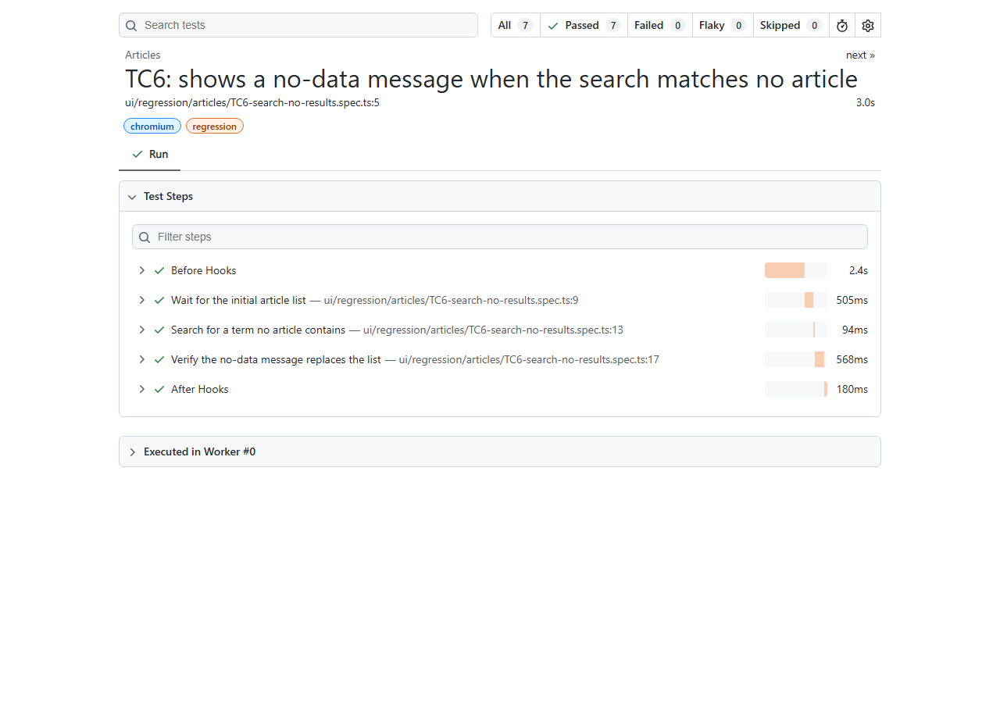
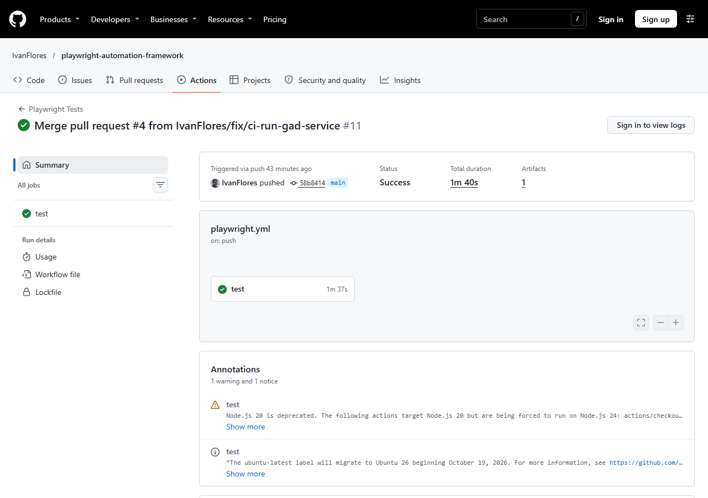
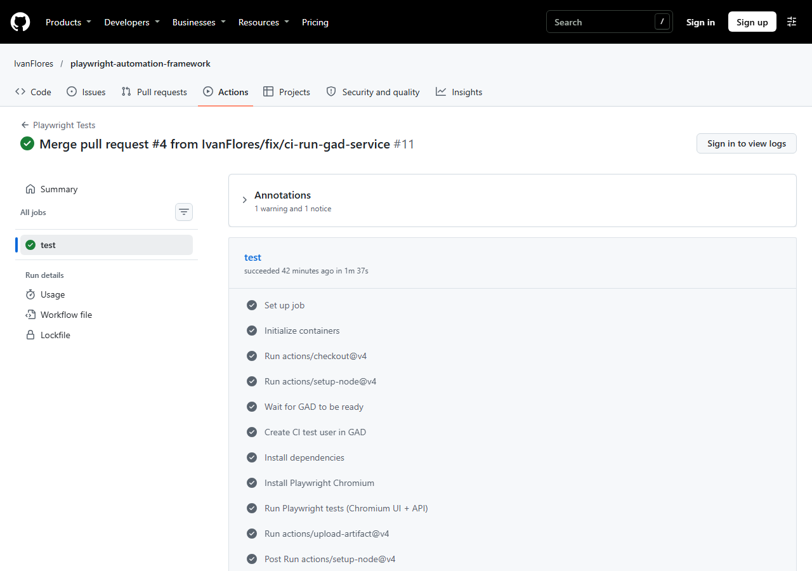

# M5 — Skills evidence (automation-architect · git-standards · spec-standards)

- Date: 2026-11-11 / 12
- AI agent: **Claude Code** (desktop app, model Claude Opus 5.5) — the course prompts were written for **Kiro**
- Project: `playwright-automation-framework` (Playwright + TypeScript, app under test: GAD at `BASE_URL`)
- Branch: `test/gad-ui-tc1-tc7` → PR into `main`
- Detailed BEFORE output: [`M5-before-report.md`](M5-before-report.md)

Task → skill mapping used in this submission:

| Task wording | Skill in this repo |
|---|---|
| automation-architect (pom-architect + test-standards) | `.claude/skills/automation-architect` (hub, Mode 1) |
| git-conventions / git-standards | `.claude/skills/git-standards` (also hub Mode 4) |
| code-conventions / spec-standards | `.claude/skills/spec-standards` (hub Mode 1, step 4) + `tsc`, ESLint, Prettier |

---

## 1. Prompt execution — adapting the Kiro meta-prompts to Claude Code

Source prompts: `docs/git-conventions-prompt.md` and `docs/spec-standards-prompt.md` from the course repo.

| # | Kiro prompt said | Adapted for Claude Code | Why |
|---|---|---|---|
| 1 | Create `.kiro/skills/<name>/SKILL.md` | `.claude/skills/<name>/SKILL.md` | Claude Code discovers project skills only under `.claude/skills/`. |
| 2 | Frontmatter `description: >` (folded YAML) | Single-quoted one-line `description` with explicit trigger phrases | Matches the existing three skills; Claude Code decides when to load a skill from `description`, so triggers must be listed there. |
| 3 | C4 architectural files include `.kiro/skills/**` | `.claude/skills/**` + `src/fixtures/index.ts` | Same reason as 1; fixtures are the other file every spec depends on. |
| 4 | C4 fix: "run Mode 5 — update readme" | "Update README manually; Mode 5 needs an ADR first" | Mode 5 does not exist in this hub; the hub's Growth Policy (Rule 2) forbids adding a mode without an ADR. |
| 5 | `git rebase -i` to reword old commits | Kept, but tagged **MANUAL** (user runs it) | Agents in Claude Code cannot drive interactive git commands. |
| 6 | Push / PR without confirmation | Added: confirm before the first push of a session; baseline commit to a brand-new `main` is the only direct push | Pushing and opening PRs are outward-facing; the repo did not exist on GitHub yet. |
| 7 | spec-standards output `Fix: … \| AUTO-APPLIED` | `Fix: … [AUTO-APPLIED \| MANUAL \| NOT APPLIED (report-only)]` + summary line | Same format as pom-architect / test-standards so the hub can aggregate it; report-only mode added. |
| 8 | Scan scope `tests/ui/**` + `tests/*.spec.ts` | `tests/**/*.spec.ts` minus `tests/api/**` and `tests/setup/**` | The original glob would have missed `tests/e2e/home.spec.ts`; API specs belong to the separate `api` project. |
| 9 | Feature folder table for an e-commerce site (products, cart…) | Table for GAD (login, home, articles, comments, register) | Must describe the real app under test. |
| 10 | — | Tags via Playwright `tag` option, informational only | Existing `npm run test:smoke` uses `--grep @smoke`, which also matches native tags. |
| 11 | Hub: add Mode 4 + register spec-standards | Done + `docs/decisions/ADR-001-git-workflow-mode.md` | Hub Growth Policy Rule 2: ADR before any new mode. |

## 2. Skill verification (BEFORE → AFTER)

### automation-architect — Mode 1

| Run | pom-architect | test-standards | spec-standards | Closing line | Format matched? |
|---|---|---|---|---|---|
| BEFORE (report-only, baseline code) | 0 | 0 | **11** (R1×2, R2×2, R3×1, R4×3, R5×3) | ⚠️ Manual fixes pending. | Yes — common `[skill] SEVERITY — RULE` blocks + PIPELINE COMPLETE summary |
| AFTER (apply, branch code) | 0 | 0 | 0 | ✅ All rules satisfied. | Yes |

AFTER output:

```
[pom-architect]  0 violations found — 0 auto-applied, 0 manual
[test-standards] 0 violations found — 0 auto-applied, 0 manual
[spec-standards] 0 violations found — 0 auto-applied, 0 manual

[automation-architect] PIPELINE COMPLETE
─────────────────────────────────────────
pom-architect:    0 violations found — 0 auto-applied
test-standards:   0 violations found — 0 auto-applied
spec-standards:   0 violations found — 0 auto-applied
Remaining manual fixes: none
[automation-architect] ✅ All rules satisfied.
```

How the 11 spec-standards findings were resolved:

| Before | After |
|---|---|
| `tests/example.spec.ts` | `tests/ui/smoke/login/TC1-valid-login.spec.ts` (`git mv`, steps added) |
| `tests/e2e/home.spec.ts` (2 TCs in one file, describe `'Home page (authenticated)'`) | split into `tests/ui/smoke/home/TC3-home-user-greeting.spec.ts` and `TC4-home-user-menu.spec.ts`, describe `'Home'` |
| test names without `TC{N}: ` | `TC1:` … `TC4:` prefixes |
| assertions outside `test.step()` | every action/assertion group inside `test.step()` |

New test cases written for this task (all pass Mode 1 with zero violations):

| TC | File | Page Object / fixture / data |
|---|---|---|
| TC2 | `tests/ui/regression/login/TC2-login-invalid-credentials.spec.ts` | `LoginPage.errorMessage`; `users.invalidUser`, `loginMessages` in `src/data/auth.data.ts` |
| TC5 | `tests/ui/smoke/articles/TC5-articles-list-pagination.spec.ts` | new `ArticlesPage` + `articlesPage` fixture (no auth) |
| TC6 | `tests/ui/regression/articles/TC6-search-no-results.spec.ts` | `ArticlesPage.search()`; `src/data/articles.data.ts` |
| TC7 | `tests/ui/regression/articles/TC7-articles-items-per-page.spec.ts` | `ArticlesPage.setItemsPerPage()` |

### git-standards — Validate

| Run | Branch | Commits | Coverage | README sync | Result |
|---|---|---|---|---|---|
| BEFORE (branch just created) | PASS | 0 / 0 | **VIOLATION** — no feat/fix | IN SYNC | ⚠️ 1 issue |
| AFTER | PASS | 4 valid / 0 invalid | PASS | IN SYNC | ✅ ready to push / open PR |

Commits on the branch:

```
docs(readme): document tc layout, test cases and m5 skills
chore(format): apply prettier to env and playwright config
feat(tests): add gad login, home and articles tcs in spec-standards layout
feat(skills): add git-standards and spec-standards skills with hub mode 4
```

C4 behaved as designed: the branch touches `.claude/skills/**`, `playwright.config.ts` and `src/fixtures/index.ts`,
so `README.md` was updated (structure, TC table, AI skills table, conventions) before validating.

### Code conventions (tooling)

| Check | BEFORE | AFTER |
|---|---|---|
| `npx tsc --noEmit` | pass | pass |
| `npx eslint src tests playwright.config.ts` | pass | pass |
| `npx prettier --check "src/**/*.ts" "tests/**/*.ts" playwright.config.ts` | 8 files flagged (new specs + `Env.ts`, `playwright.config.ts`) | all files pass |

## 3. Prompt iteration — what had to change and why

1. **Skill cache in Claude Code.** The first hub run after editing `automation-architect/SKILL.md` was served the
   copy loaded at session start (no Mode 4, no spec-standards). The hub was then applied from the file on disk, and
   the next invocation picked up the new version. Lesson: after editing a skill, re-invoke it (or start a new
   session) and check the loaded text before trusting the output.
2. **Scope glob (prompt R1 table).** With the original `tests/ui/**` + `tests/*.spec.ts` scope,
   `tests/e2e/home.spec.ts` was invisible to the skill. Changed to `tests/**/*.spec.ts` minus `api/` and `setup/`.
3. **One TC per file vs. existing home spec.** The home spec held two independent tests; R1 requires splitting,
   so it became TC3 + TC4 instead of one merged TC (merging would have changed what is verified).
4. **Prettier vs. the R5 example.** The `test(name, { tag }, async () => {…})` signature exceeds the
   100-character print width, so Prettier wraps it; detection must not rely on fixed indentation (my first scripted
   R5 check reported a false positive on TC3 because of that).
5. **README sync.** C4 points at a Mode 5 that does not exist here; rewritten to manual guidance instead of inventing
   a mode without an ADR.
6. **Not a git repository.** The project folder had no `.git`; git-standards could not validate anything. Added
   the "not a git repository" branch to Validate and created a `chore:` baseline commit on `main`.

## 4. Test execution — Playwright HTML report (Chromium)

Command: `npx playwright test --project=chromium` → **7 passed, 0 failed, 0 flaky (10.3 s)**.

```
ok [chromium] › ui/regression/articles/TC6-search-no-results.spec.ts › Articles › TC6 … @regression
ok [chromium] › ui/smoke/articles/TC5-articles-list-pagination.spec.ts › Articles › TC5 … @smoke
ok [chromium] › ui/regression/login/TC2-login-invalid-credentials.spec.ts › Login › TC2 … @regression
ok [chromium] › ui/regression/articles/TC7-articles-items-per-page.spec.ts › Articles › TC7 … @regression
ok [chromium] › ui/smoke/home/TC3-home-user-greeting.spec.ts › Home › TC3 … @smoke
ok [chromium] › ui/smoke/home/TC4-home-user-menu.spec.ts › Home › TC4 … @smoke
ok [chromium] › ui/smoke/login/TC1-valid-login.spec.ts › Login › TC1 … @smoke
7 passed (10.3s)
```

Note: the first run had TC1 and TC3 failing with GAD's "Invalid username or password" — the GAD data had been reset,
so the account in `.env` no longer existed. After updating `.env` (values are never committed), all 7 passed. TC4
passes even when logged out (the menu button is always rendered), so it is a weak signal; a stronger check is a
candidate for a future TC.




### 4.1 CI run on main (GitHub Actions)

Before PR #4, every CI run failed at startup: the workflow had no `BASE_URL` / `TEST_USERNAME` /
`TEST_PASSWORD`, and the tests targeted a GAD on the developer machine that GitHub runners cannot reach.
PR #4 made CI self-contained:

- GAD runs as a service container (`jaktestowac/gad:2.9.0`).
- A throwaway user is registered via `POST /api/users`; its password is random and masked in the logs.
- The job runs Chromium plus the API project.

| Item | Value |
|---|---|
| Run | [#11](https://github.com/IvanFlores/playwright-automation-framework/actions/runs/43143484958) — push to `main` (merge of PR #4, `58b8414`) |
| Duration | 1m 40s |
| Result | **Success — 9 passed** (TC1–TC7 Chromium + 2 API), 0 failed |




## 5. Screenshots of written files

All in [`screenshots/`](screenshots/):

| File | Screenshot |
|---|---|
| `.claude/skills/git-standards/SKILL.md` | `01-skill-git-standards.png` |
| `.claude/skills/spec-standards/SKILL.md` | `02-skill-spec-standards.png` |
| `.claude/skills/automation-architect/SKILL.md` | `03-skill-automation-architect.png` |
| `docs/decisions/ADR-001-git-workflow-mode.md` | `04-adr-001.png` |
| `src/ui/pages/ArticlesPage.ts` | `05-page-ArticlesPage.png` |
| `src/fixtures/index.ts` | `06-fixtures-index.png` |
| `src/data/auth.data.ts`, `src/data/articles.data.ts` | `07-data-auth.png`, `08-data-articles.png` |
| TC1–TC7 spec files | `09-spec-TC1.png` … `15-spec-TC7.png` |
| BEFORE report | `16-before-report.png` |
| HTML report | `20-html-report-summary.png`, `21-html-report-TC6-steps.png` |
| CI run on `main` | `22-ci-run-summary.png`, `23-ci-job-steps.png` |

Repository: https://github.com/IvanFlores/playwright-automation-framework
