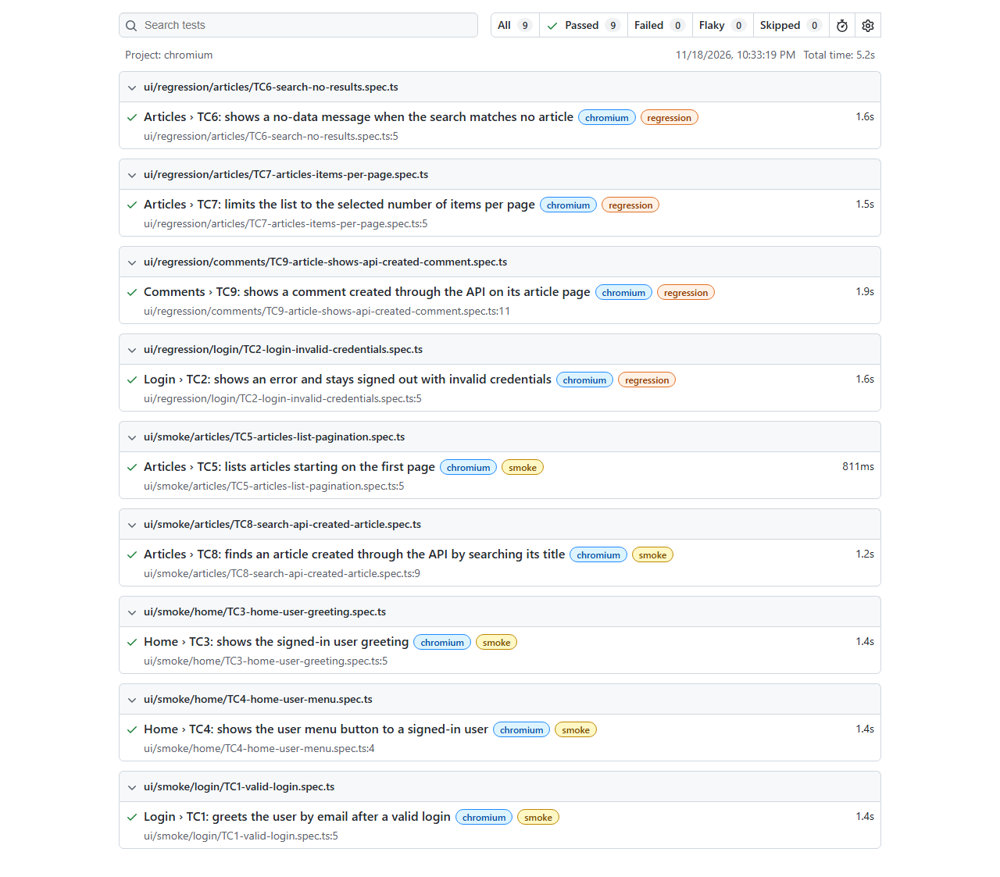
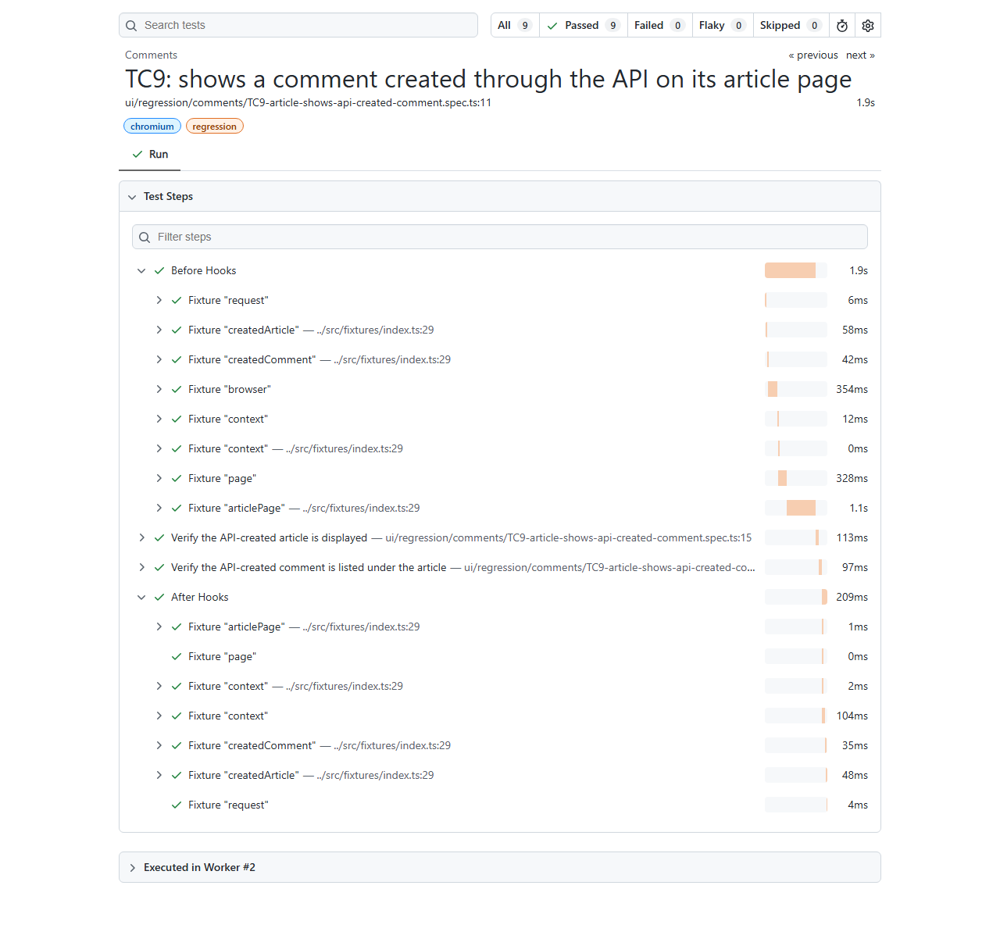
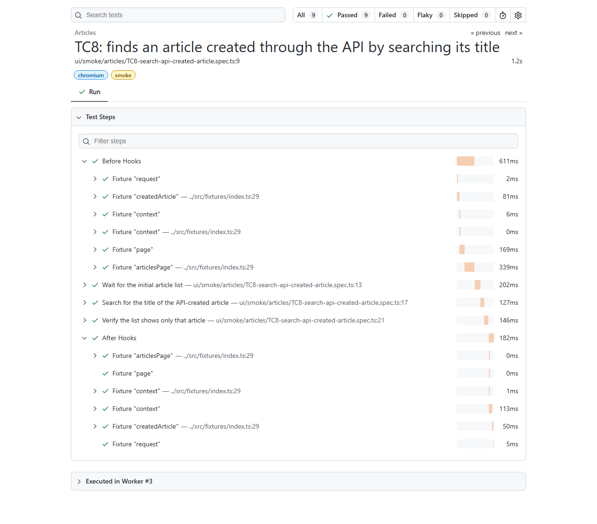

# M6 — Test execution evidence

- Date: 2026-11-18
- App under test: GAD at `http://localhost:3001` (local)
- Command: `npx playwright test --project=chromium`
- Result: **9 passed, 0 failed, 0 flaky, 0 skipped** (5.2 s)
- HTML report: `playwright-report/` (open with `npm run report`); the CI run on the PR uploads the
  same report as the `playwright-report` artifact.
- The local HTML report is **not committed**: its step data contains the values typed by
  `LoginPage.login()`, so it would include the real test-account password from `.env`. The
  screenshots below were taken from that report.

## The two M6 test cases

| TC | Spec | Precondition (API) | UI verification | Postcondition (API) |
|---|---|---|---|---|
| TC8 | `tests/ui/smoke/articles/TC8-search-api-created-article.spec.ts` | `createdArticle`: `POST /api/login`, `POST /api/articles` (unique title) | search the list for the title → exactly that article | `DELETE /api/articles/:id` |
| TC9 | `tests/ui/regression/comments/TC9-article-shows-api-created-comment.spec.ts` | `createdArticle` + `createdComment`: `POST /api/comments` | article page shows title, body and the comment card | `DELETE /api/comments/:id`, then `DELETE /api/articles/:id` |

The report's step view shows the lifecycle order — setup in "Before Hooks", teardown in
"After Hooks" (comment removed before its article):

## Additional runs

| Command | Result |
|---|---|
| `npx tsc --noEmit` | no errors |
| `npx eslint .` | no errors |
| `npx playwright test --project=chromium --project=api` | 11 passed (9 UI + 2 API refactored to `postController`) |
| `npx playwright test TC8 TC9 --repeat-each=5` (chromium, firefox, webkit) | 30 passed |
| `cucumber-js --profile api` (after moving `ApiClient`) | 2 scenarios / 5 steps passed |
| `GET /api/articles`, `GET /api/comments` after the runs | 0 leftover "Lifecycle article" / "Lifecycle comment" records |
