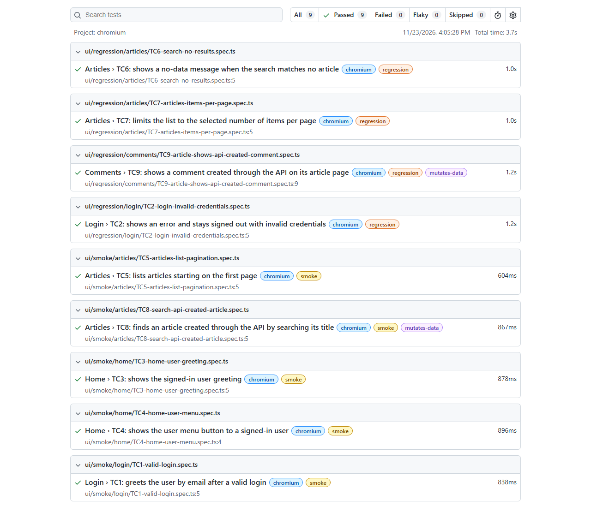
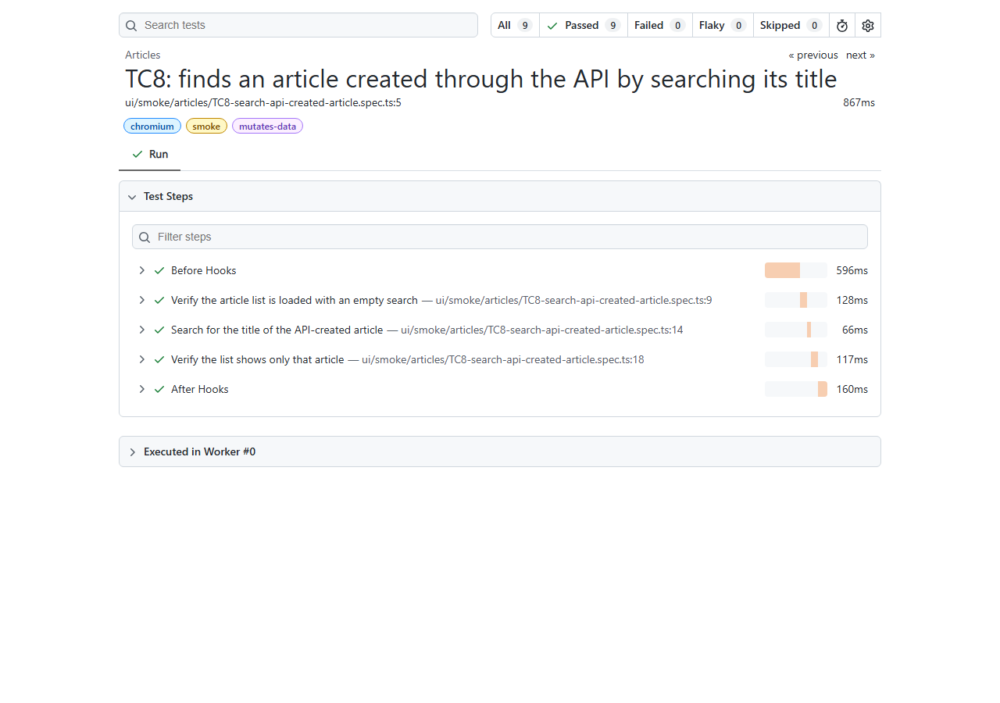
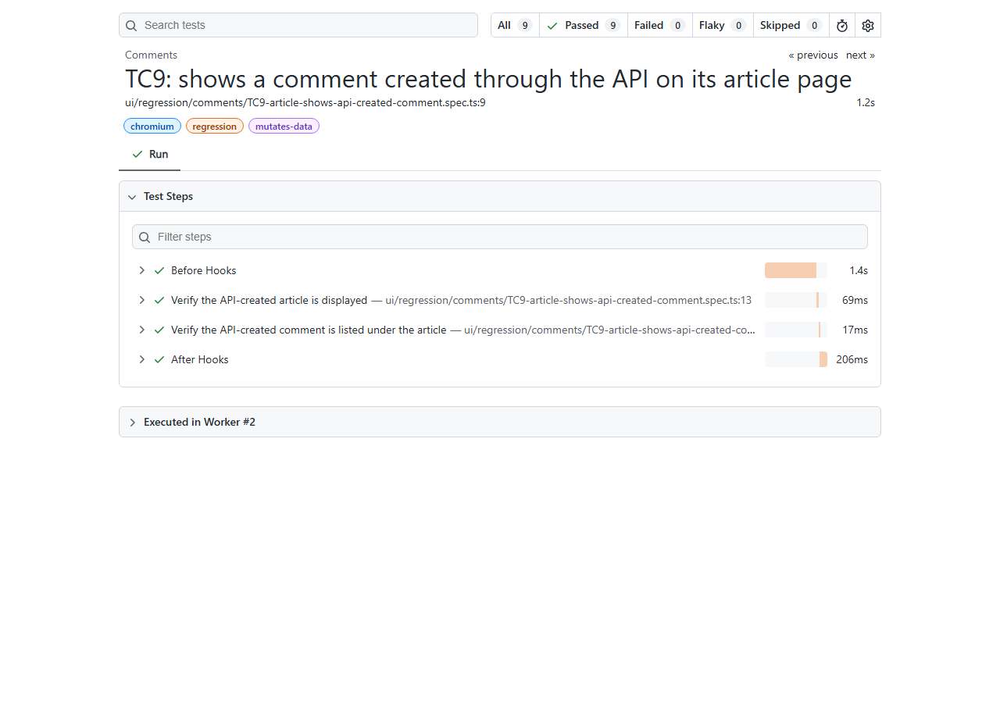

# M7 — Test execution evidence

- Date: 2026-11-23 · GAD 2.9.0 at `http://localhost:3001` · Playwright 1.64 · Windows 11
- Command: `npx playwright test --project=chromium` (HTML reporter, `playwright-report/`)

## Playwright HTML report — Chromium

**9 passed · 0 failed · 0 flaky · 0 skipped — 3.7 s**



| TC | Suite | Tags | Result |
|---|---|---|---|
| TC1 | smoke | `@smoke` | ✅ |
| TC2 | regression | `@regression` | ✅ |
| TC3 | smoke | `@smoke` | ✅ |
| TC4 | smoke | `@smoke` | ✅ |
| TC5 | smoke | `@smoke` | ✅ |
| TC6 | regression | `@regression` | ✅ |
| TC7 | regression | `@regression` | ✅ |
| **TC8** | smoke | `@smoke` `@mutates-data` | ✅ |
| **TC9** | regression | `@regression` `@mutates-data` | ✅ |

TC8 steps (fixtures `workerUser` → `createdArticle` in *Before Hooks*, deletes in *After Hooks*):



TC9 steps:



## Additional runs

| Run | Result |
|---|---|
| TC8 + TC9, chromium, `--workers=4 --repeat-each=4 --retries=0` (before fixes) | 8/8 · 21.9 s |
| same, after fixes | 8/8 · 5.8 s |
| TC8 + TC9, chromium + firefox + webkit, 4 × 4 | 24/24 |
| firefox + webkit + api (full projects), 3 consecutive runs | 20/20 each |
| `npm run data:orphans` after the runs | users 1 (`id 18`, see `06-prompt-iteration.md` #8) · articles 0 · comments 0 |
| `npx tsc --noEmit` · `npx eslint .` | clean |

Reproduce:

```powershell
npx playwright test --project=chromium
```

```powershell
npm run report
```
