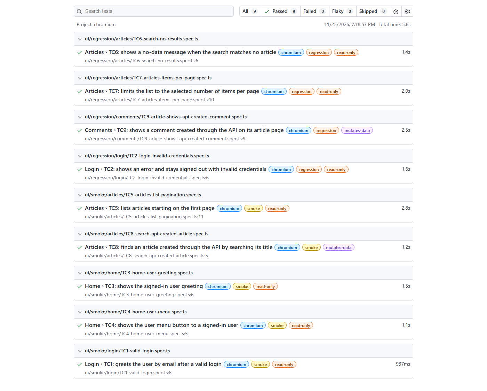

# 05 — Test execution evidence: Playwright HTML report, Chromium

Command (after the M1→M5 refactor, local GAD at `BASE_URL`):

```powershell
npx playwright test --project=chromium
```

```powershell
npm run report
```

Result: **9 passed · 0 failed · 0 flaky · 0 skipped** (5.8 s, 2026-11-25 19:18). The `chromium`
project runs every UI spec (TC1–TC9); `tests/api/**` belongs to the `api` project.

| Screenshot | What it shows |
|---|---|
| [`01-html-report-chromium-summary.png`](screenshots/01-html-report-chromium-summary.png) | HTML report summary — all 9 TCs green on `chromium`, with their suite and data-impact tags |
| [`02-html-report-TC8-steps.png`](screenshots/02-html-report-TC8-steps.png) | TC8 steps: `not.toHaveCount(0)` on `getByTestId(/^article-\d+-title$/)`, search, exact count + title |
| [`03-html-report-TC9-steps.png`](screenshots/03-html-report-TC9-steps.png) | TC9 steps: article checks through `getByTestId(...)` (tier 1 under the declared contract), then the comment checks |



## Repeat runs (M6) on the two TCs

| Run | Command | Result |
|---|---|---|
| Before refactor | `npx playwright test TC8 TC9 --project=chromium --repeat-each=5 --workers=4 --retries=0 --trace=retain-on-failure` | 10/10 |
| After refactor | same | 10/10 |
| After refactor, re-check with orphan count | same + `npx tsx scripts/orphan-check.ts` before and after | 10/10 · orphans unchanged (2 pre-existing users, see `03` §6) |

Static checks after the refactor: `npx tsc --noEmit` ✅ · `npx eslint src tests playwright.config.ts` ✅.
